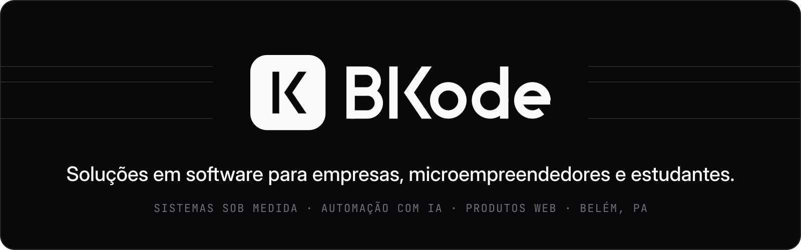
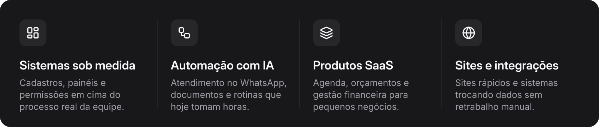
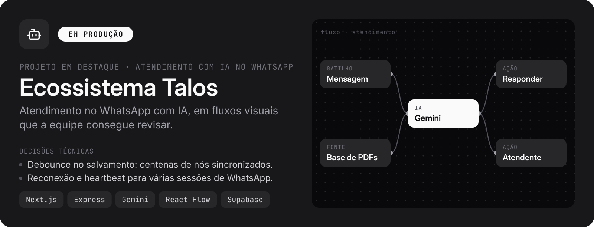
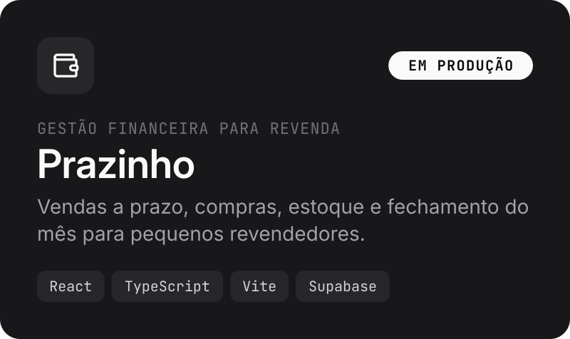
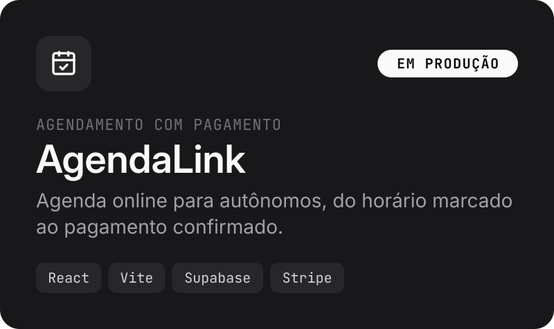
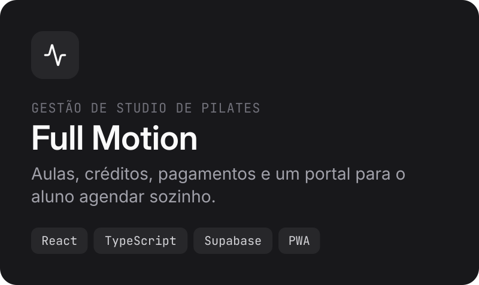
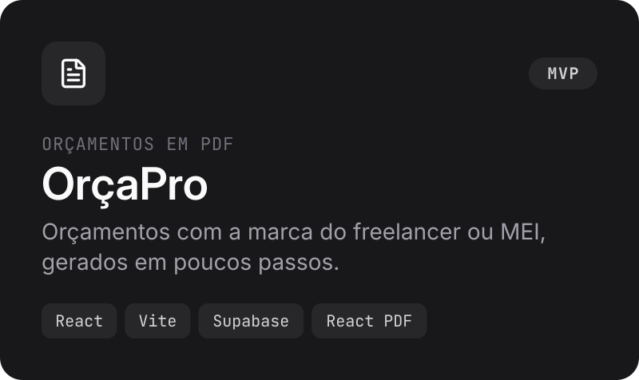
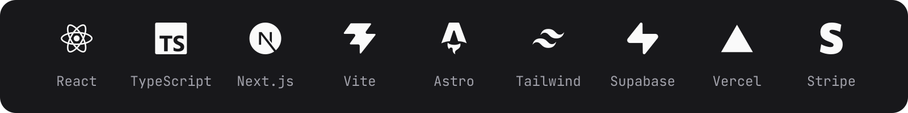

  

  
  
  

 

A **BKode** desenvolve software sob medida em Belém, PA: sistemas internos, automação com IA e produtos web para empresas, microempreendedores, profissionais autônomos e estudantes.

### O que construímos

### Projetos

Desenvolvidos por [@bk-marcosr](https://github.com/bk-marcosr), fundador da BKode. Os repositórios são privados.

  
  

  
  

### Stack

 

   
  BKode · Belém, PA · <a href="mailto:bkode.corp@gmail.com">bkode.corp@gmail.com</a>

