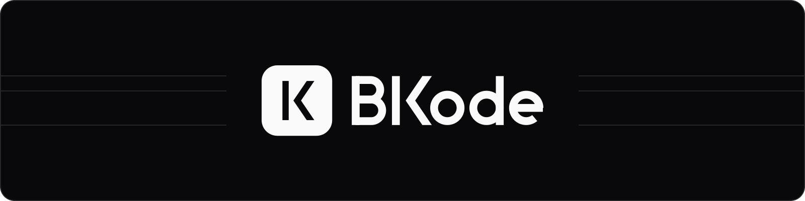

  

  Sistemas sob medida, automação com IA e produtos web 
  para empresas, microempreendedores e estudantes.

  Belém, PA &nbsp;·&nbsp; <a href="mailto:bkode.corp@gmail.com">bkode.corp@gmail.com</a>

 

### Projetos

Desenvolvidos por [@bk-marcosr](https://github.com/bk-marcosr), fundador da BKode.

**Ecossistema Talos** &nbsp;`em produção`  
Atendimento com IA no WhatsApp, com editor visual de fluxos que a equipe revisa.  
Next.js · Express · Gemini · React Flow · Supabase

**Prazinho** &nbsp;`em produção`  
Vendas a prazo, compras, estoque e fechamento do mês para pequenos revendedores.  
React · TypeScript · Vite · Supabase

**AgendaLink** &nbsp;`em produção`  
Agenda online para autônomos, do horário marcado ao pagamento confirmado.  
React · Vite · Supabase · Stripe

**Full Motion**  
Gestão de studio de pilates: aulas, créditos, pagamentos e portal do aluno.  
React · TypeScript · Supabase · PWA

**OrçaPro** &nbsp;`mvp`  
Orçamentos em PDF com a marca do freelancer ou MEI.  
React · Vite · Supabase · React PDF

 

### Stack

  <picture><source media="(prefers-color-scheme: dark)" srcset="https://cdn.simpleicons.org/react/FAFAFA"></picture>&nbsp;&nbsp;&nbsp;
  <picture><source media="(prefers-color-scheme: dark)" srcset="https://cdn.simpleicons.org/typescript/FAFAFA"></picture>&nbsp;&nbsp;&nbsp;
  <picture><source media="(prefers-color-scheme: dark)" srcset="https://cdn.simpleicons.org/nextdotjs/FAFAFA"></picture>&nbsp;&nbsp;&nbsp;
  <picture><source media="(prefers-color-scheme: dark)" srcset="https://cdn.simpleicons.org/vite/FAFAFA"></picture>&nbsp;&nbsp;&nbsp;
  <picture><source media="(prefers-color-scheme: dark)" srcset="https://cdn.simpleicons.org/astro/FAFAFA"></picture>&nbsp;&nbsp;&nbsp;
  <picture><source media="(prefers-color-scheme: dark)" srcset="https://cdn.simpleicons.org/tailwindcss/FAFAFA"></picture>&nbsp;&nbsp;&nbsp;
  <picture><source media="(prefers-color-scheme: dark)" srcset="https://cdn.simpleicons.org/supabase/FAFAFA"></picture>&nbsp;&nbsp;&nbsp;
  <picture><source media="(prefers-color-scheme: dark)" srcset="https://cdn.simpleicons.org/vercel/FAFAFA"></picture>&nbsp;&nbsp;&nbsp;
  <picture><source media="(prefers-color-scheme: dark)" srcset="https://cdn.simpleicons.org/stripe/FAFAFA"></picture>

